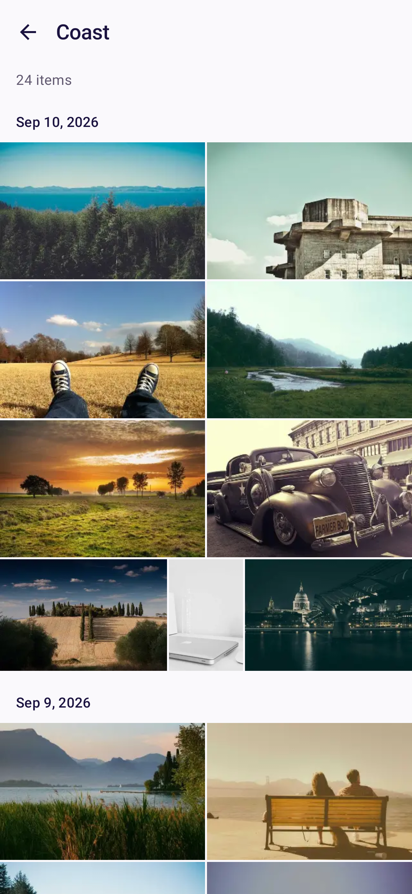

<div align="center">

<a href="images/logo.svg"></a>

# Proton Gallery

**Your photos, on your phone and in Proton Drive.** A native Android gallery with a shared
photo timeline, automatic backup, Proton Photos albums, and Drive folders as galleries.

**[proton-gallery.narl.io](https://proton-gallery.narl.io)**

[](https://github.com/narrrl/proton-gallery/actions/workflows/android.yml)
[](#install)
[](#building)
[](LICENSE)

[Getting started](#getting-started) · [Build the app](#building) · [Documentation](#documentation)

</div>

Proton Gallery brings your phone's photos and your Proton Photos library into one timeline.
Add ordinary Drive folders as galleries, browse their nested albums, and back up selected
phone folders in the background. Kotlin and Compose provide the Android interface; Rust owns
the catalog, account integration, and media operations.

This is an independent, unofficial client and is not affiliated with or endorsed by Proton AG.

## Features

**Photos and albums**

- **One timeline.** Browse phone photos and Proton Photos together. Matching backed-up copies
  appear once, and the app uses the phone file when it is available.
- **A grid that follows your photos.** Portraits and landscapes fit into justified rows with
  narrow gutters. Pinch to zoom; date headings adapt from days to months and years.
- **Proton Photos albums.** Albums have their own tab. Create and rename albums, add or
  remove photos, and delete an album while keeping its photos in the timeline.
- **Favorites.** Mark photos as favorites from the viewer or a selection. Proton media uses
  Proton's Favorite tag; phone media uses Android's own favorites.
- **View and share.** Open photos, stream Proton videos with seeking, page through the whole
  view, hide the controls with a tap, select multiple items, and share phone or Proton
  originals with other apps.
- **Hidden albums.** Hide photos into a hidden album in one step. Hidden albums and their
  photos leave the timeline, visible album lists, and Android’s photo picker. Open a
  hidden album with your phone’s screen lock or a local Gallery passphrase on desktop.

**Backup and storage**

- **Automatic backup.** Choose phone folders, use Wi-Fi-only or charging-only conditions,
  and follow progress in the app or its notification. Start a backup manually or back up a
  selection immediately.
- **Back up into albums.** Send each phone folder into a Proton album of its own (Camera
  into "Camera"), and every backup into one more album, such as one named after the phone.
- **Duplicate checks.** Existing copies are checked before upload. Different files with the
  same name get a new name instead of overwriting one another.
- **Free up space.** Remove older phone copies after confirming they are backed up in Proton.
  Android asks for permission before removing them.
- **Clear deletion controls.** Send selected media to the phone's trash, Proton's trash, or
  both when it exists in both places.

**Drive galleries**

- **Any folder can be a gallery.** Choose a folder from My files; its subfolders become nested
  albums. Removing a gallery from the app leaves the Drive files untouched.
- **Make albums easier to find.** Set local names, descriptions, covers, tags, and pins,
  or hide an album behind the phone's lock.
- **Keep Photos and Drive separate.** The top bar switches between the Photos timeline and
  your chosen folder galleries, while both use the same grid and viewer.
- **Public Drive links.** Share an owned gallery folder with viewer access, an
  optional password, and an optional expiry. Open the folder’s public-link panel
  to copy or revoke its link.

The app also offers light, dark, and device themes, native sign-in with two-factor
authentication, and photo selection for other Android apps. Android 13+ cloud photo-picker
integration is available with an additional device setup step; see the
[Android guide](docs/ANDROID.md#androids-system-photo-picker).

## Screenshots

<table>
  <tr>
    <td align="center"><a href="images/photos.png"></a><br><sub>Photos</sub></td>
    <td align="center"><a href="images/albums.png"></a><br><sub>Albums</sub></td>
    <td align="center"><a href="images/drive.png"></a><br><sub>Drive galleries</sub></td>
    <td align="center"><a href="images/backup.png"></a><br><sub>Backup</sub></td>
  </tr>
</table>

Actual Android UI captures using the same public demo photographs as Proton Drive, with synthetic library metadata; no private photo library is shown.

## Install

The Android app supports **Android 12 / API 31 or newer**, on `arm64-v8a` phones and
`x86_64` emulators. Download the signed APK from
[Releases](https://github.com/narrrl/proton-gallery/releases), or build the current app from
source using the steps below.

| Component | Current availability |
| --- | --- |
| Android app | Native Compose gallery, connected to Proton Photos and Drive |
| Rust core and CLI | Local catalog, indexing, and headless diagnostics |
| Linux and Windows desktop apps | Native Rust/Iced gallery with a virtualized Photos timeline, albums, favorites, and nested Drive galleries. Linux also supports in-app video playback. ([Desktop guide](docs/DESKTOP.md)) |

Run the desktop browser with `cargo run -p pg-desktop --bin proton-gallery --locked`,
or browse account-free fixtures with `-- --demo 100000`. Android retains its Compose
interface and UniFFI bridge; both frontends share application workflows in `pg-app`.
The Compose desktop skeleton is retained while Iced runtime acceptance remains open.

Linux packages install the **Proton Gallery** application-menu entry and
`proton-gallery` command. Build and install from this checkout on Arch with
`cd packaging && makepkg -fi` (or `makepkg -sfi` to install missing dependencies).
See the [Linux packaging guide](packaging/README.md) for Debian/Ubuntu and Fedora
installers and local build instructions.

## Getting started

1. Open **Proton Gallery** and allow access to the phone photos and videos you want to see.
2. Open the account sheet and sign in to Proton. Your Photos library syncs into the timeline.
3. Open **Backup** to choose phone folders and network or charging conditions.
4. Switch to **Drive** and use **Add gallery** to choose a folder. Open its albums to browse
   photos and videos or customize their covers and tags.

The Android app is usable and under active development. Proton videos stream: playback and
seeking start while the rest of the video downloads, and nothing is written to disk.
Encrypted local caches and full offline copies of remote albums are still being developed. The first sync of a large library can take time.
The [Android guide](docs/ANDROID.md) describes current behavior and platform limitations.

## Privacy and local storage

- **Sessions are protected locally.** Android Keystore protects the saved session. Login and
  mailbox passwords are not persisted.
- **Browsing uses a local index.** The app stores photo metadata in a private SQLite database
  so navigation does not depend on reading the full remote library again.
- **Viewing and sharing can create local copies.** Thumbnails are kept as small WebP files
  (up to 256 MB) in the app's cache. Opened and shared originals and system-picker previews
  are decrypted into app-private cache storage; copies older than a day are removed. The
  metadata database and these caches are not encrypted beyond Android's app sandbox.
- **Hidden albums are an app-level privacy control.** Refresh the upgraded Android
  app first to import the hides you already made on your phone. Then refresh your other
  Gallery devices. Gallery stores these settings in an end-to-end encrypted Proton Drive
  device named **Proton Gallery settings**. Changes reach each device during its next
  successful sync. Originals remain visible in Proton Photos, older Gallery versions,
  and to recipients who already have access.
- **Signing out removes the account's local data.** The catalog forgets decrypted names,
  album titles, backup state, and photo-picker previews for that account.

See [Android storage and account behavior](docs/ANDROID.md) and
[architecture](docs/ARCHITECTURE.md) for the implementation details.

## Building

For Android, use a Linux build host with **JDK 21**, **Rust 1.96+**, Android SDK platform 36,
build tools 37.0.0, and NDK 30.0.16248370. The Gradle wrapper is included.

```sh
rustup target add aarch64-linux-android x86_64-linux-android
cargo install cargo-ndk --version 4.1.2 --locked

export JAVA_HOME=/path/to/jdk-21
export ANDROID_HOME=/path/to/android-sdk
export ANDROID_NDK_HOME="$ANDROID_HOME/ndk/30.0.16248370"

bash scripts/build-android.sh debug
```

The APK is written to `android/app/build/outputs/apk/debug/app-debug.apk`. Gradle builds the
Rust library and generates the Kotlin bindings; no sibling checkout is required.
For release signing and a separate **Proton Gallery Testing** installation, see the
[signed-build guide](docs/ANDROID.md#signed-device-testing-build).

The CLI can also run without Android or a Proton account:

```sh
cargo run -p pg-cli -- --data-dir /tmp/proton-gallery-demo demo --count 10000
cargo run -p pg-cli -- --data-dir /tmp/proton-gallery-demo list --limit 20
```

These commands use synthetic data. The [development guide](docs/DEVELOPMENT.md) covers
real-account indexing, diagnostics, and the core storage boundaries.

## Documentation

| Guide | Contents |
| --- | --- |
| [Android](docs/ANDROID.md) | App behavior, sign-in, backup, picker integration, builds, and device testing |
| [Desktop browser](docs/DESKTOP.md) | Iced launch commands, shared services, limits and acceptance gaps |
| [Development](docs/DEVELOPMENT.md) | Rust workspace, CLI commands, local fixtures, and checks |
| [Architecture](docs/ARCHITECTURE.md) | Data ownership, indexing, media storage, and platform boundaries |
| [Validation](docs/VALIDATION.md) | Recorded checks, measurements, and device-testing results |
| [Product direction](docs/PRODUCT.md) | Photos and Drive gallery concepts and design history |
| [Implementation plan](docs/IMPLEMENTATION_PLAN.md) | Remaining engineering work and acceptance gates |
| [Branding](images/BRANDING.md) | Editable SVG sources and reproducible platform icon exports |

## Contributing

Issues and patches are welcome. Include the Android version, what you expected, and steps
to reproduce a problem. Keep account credentials and private photo details out of reports.

Run `bash scripts/check.sh` for the Rust checks and `bash scripts/build-android.sh check`
for Android unit tests, lint, and a debug build. Core behavior belongs in Rust; Compose and Iced own
the Android interface and platform integration.

## License

Released under the [MIT License](LICENSE). [NOTICE.md](NOTICE.md) records design and source
provenance, and the app bundles the relevant third-party notices.

Part of the same independent project family as
[Proton Drive for Linux](https://github.com/narrrl/proton-drive-linux),
[Proton Stream](https://github.com/narrrl/proton-stream), and
[proton-sdk-rs](https://github.com/narrrl/proton-sdk-rs).
