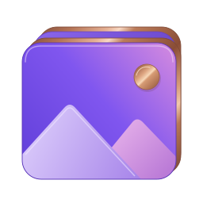
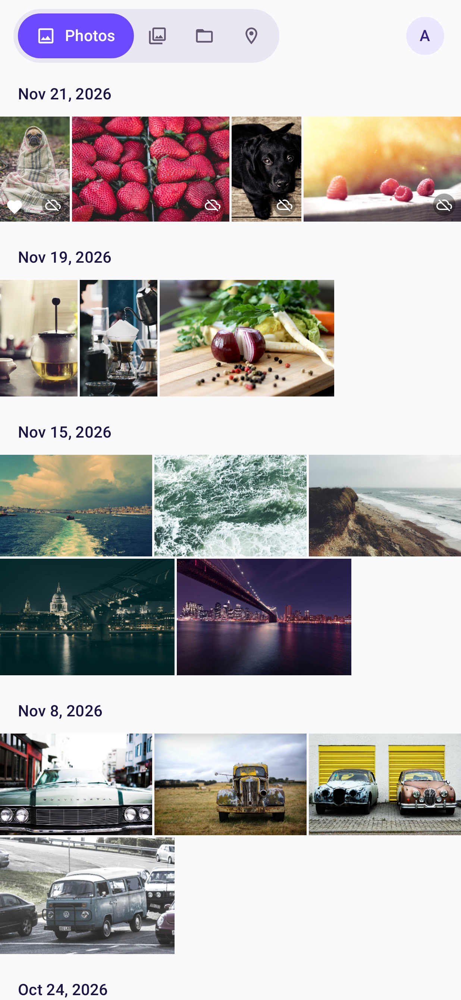
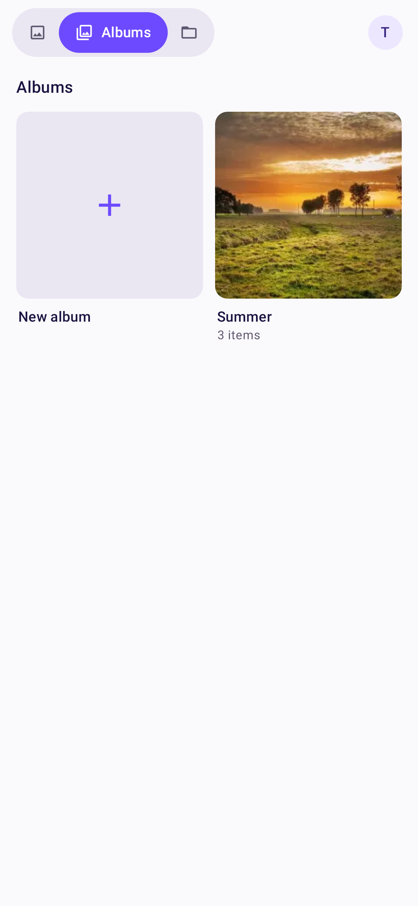
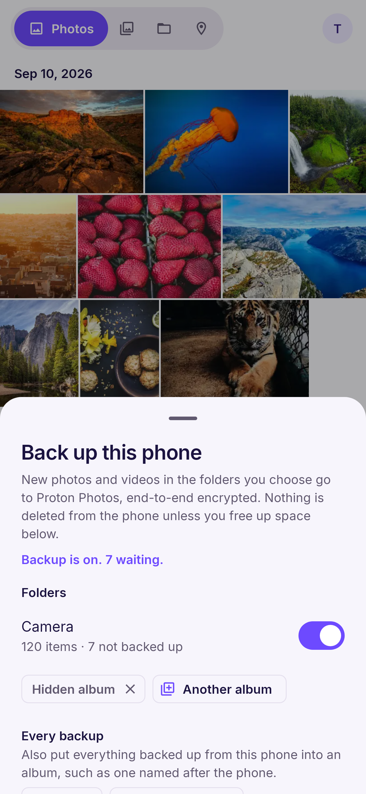

<div align="center">

<a href="images/logo.svg"></a>

# Proton Gallery

**Your photos, on your phone and in Proton Drive.** An open-source gallery for
Proton Photos and Drive with native Android and desktop apps.

**[proton-gallery.narl.io](https://proton-gallery.narl.io)**

[](https://github.com/narrrl/proton-gallery/actions/workflows/android.yml)
[](https://github.com/narrrl/proton-gallery/actions/workflows/desktop.yml)
[](#install)
[](#building)
[](LICENSE)

[Install](#install) · [Getting started](#getting-started) · [Documentation](#documentation)

</div>

Proton Gallery brings your phone’s photos and your Proton Photos library into one timeline
on Android. Back up selected phone folders in the background, then browse your Proton Photos
albums and favorites on desktop. Both apps can turn ordinary Drive folders into nested
galleries and sync gallery selections and hiding settings through your Proton account.

This is an independent, unofficial client and is not affiliated with or endorsed by Proton AG.

## Features

**Photos and albums**

- **One Android timeline.** Browse phone photos and Proton Photos together. Matching backed-up copies
  appear once, and the app uses the phone file when it is available.
- **Justified photo grid.** Portraits and landscapes keep their proportions. Adjust
  density with pinch gestures on Android or the size control on desktop.
- **Proton Photos albums.** Browse albums on both platforms. Android can create and
  rename them, change their membership, and delete an album while keeping its photos.
- **Favorites.** Mark photos as favorites from the viewer or a selection. Proton media uses
  Proton's Favorite tag; phone media uses Android's own favorites.
- **View and share.** Browse photos in the viewer. Android and Linux can stream and
  seek within supported Proton videos. Android also shares selected originals with other apps.
- **Hidden albums.** Hide photos into a hidden album in one step. Hidden albums and their
  photos leave the timeline, visible album lists, and Gallery’s Android cloud picker. Open a
  hidden album with your phone’s screen lock or a local Gallery passphrase on desktop.

**Android backup and storage**

- **Automatic backup.** Choose phone folders, use Wi-Fi-only or charging-only conditions,
  and follow progress in the app or its notification. Start a backup manually or back up a
  selection immediately.
- **Back up into albums.** Send each phone folder into a Proton album of its own (Camera
  into "Camera"), and every backup into one more album, such as one named after the phone.
- **Duplicate checks.** Existing copies are checked before upload. Different files with the
  same name get a new name instead of overwriting one another.
- **Free up space.** Remove older phone copies after confirming they are backed up in Proton.
  Android asks for permission before removing them.
- **Clear deletion controls.** Send selected media to the phone's trash, Proton's trash, or
  both when it exists in both places.

**Drive galleries**

- **Any folder can be a gallery.** Choose a folder from My files; its subfolders become nested
  albums. Removing a gallery from the app leaves the Drive files untouched.
- **Customize albums on Android.** Set display names, descriptions, covers, tags,
  and pins. These settings sync alongside selected gallery folders and hidden albums.
- **Keep Photos and Drive separate.** The top bar switches between the Photos timeline and
  your chosen folder galleries, while both use the same grid and viewer.
- **Public Drive links.** Share an owned gallery folder with viewer access, an
  optional password, and an optional expiry. Open the folder’s public-link panel
  to copy or revoke its link.

The app also offers light, dark, and device themes, native sign-in with two-factor
authentication, and photo selection for other Android apps. Android 13+ cloud photo-picker
integration is available with an additional device setup step; see the
[Android guide](docs/ANDROID.md#androids-system-photo-picker).

## Screenshots

<table>
  <tr>
    <td align="center"><a href="images/photos.png"></a><br><sub>Photos</sub></td>
    <td align="center"><a href="images/albums.png"></a><br><sub>Albums</sub></td>
    <td align="center"><a href="images/drive.png"></a><br><sub>Drive galleries</sub></td>
    <td align="center"><a href="images/backup.png"></a><br><sub>Backup</sub></td>
  </tr>
</table>

Actual Android UI captures using the same public demo photographs as Proton Drive, with synthetic library metadata; no private photo library is shown.

[](docs/DESKTOP.md#desktop-presentation)

## Install

| Platform | Installation |
| --- | --- |
| Android 12 or later | Signed APK for arm64 and x86_64. [GitHub Releases](https://github.com/narrrl/proton-gallery/releases/latest) |
| Ubuntu 24.04 and Debian 13 (x86_64) | Download the `.deb` from the release and install with `sudo apt install ./proton-gallery_*_amd64.deb`. [Linux packaging guide](packaging/README.md) |
| Fedora (x86_64) | Download the signed `.rpm` and public key from the release. [Install and verify the RPM](packaging/README.md#debian-ubuntu-and-fedora) |
| Arch Linux (x86_64) | In the desired source checkout, run `cd packaging && makepkg -fi`. Use `makepkg -sfi` if dependencies are missing. [Arch prerequisites](packaging/README.md#arch-linux) |
| Windows | Build the Iced app from source. Windows video currently shows a preview. [Desktop guide](docs/DESKTOP.md) |

Linux packages install the **Proton Gallery** launcher, icon, and `proton-gallery` command.

## Getting started

1. Open **Proton Gallery** and sign in to Proton. The first library sync can take time.
2. Open **Photos**, **Albums**, or **Favorites** to browse your library.
3. Open **Drive** and choose **Add gallery** to browse a folder and its subfolders.
4. On Android, grant photo access to include phone media. Open **Backup** to choose
   phone folders, destination albums, and Wi-Fi or charging conditions.

Supported videos stream from Proton as the player requests byte ranges. Android can
fall back to an app-private file when streaming cannot open. Full offline retention
of remote albums is still under development. [Android guide](docs/ANDROID.md) ·
[Desktop guide](docs/DESKTOP.md)

## Privacy and local storage

- **Sessions are protected locally.** Android uses Keystore, Linux uses Secret Service,
  and Windows uses Credential Manager. Login and mailbox passwords are kept in memory.
- **Browsing uses a local index.** The app stores photo metadata in a private SQLite database
  so navigation does not depend on reading the full remote library again.
- **Viewing and sharing can create local copies.** Android caches thumbnails and picker
  previews, and may cache decrypted originals for viewing or sharing. Desktop holds
  decoded thumbnails in memory and clears temporary decrypted originals at next startup
  or sign-out. Local catalog metadata and these files rely on OS storage protection.
- **Hidden albums are an app-level privacy control.** Refresh the upgraded Android
  app first to import the hides you already made on your phone. Then refresh your other
  Gallery devices. Gallery stores these settings in an end-to-end encrypted Proton Drive
  device named **Proton Gallery settings**. Background checks use Proton volume event
  cursors to skip settings reconciliation when nothing changed. Media refresh still scans
  the selected library scope. Originals remain accessible in Proton Photos or Drive,
  older Gallery versions, and through existing shares.
- **Signing out removes the account's local data.** The catalog forgets decrypted names,
  album titles, backup state, and photo-picker previews for that account.

See [Android storage and account behavior](docs/ANDROID.md) and
[architecture](docs/ARCHITECTURE.md) for the implementation details.

## Building

For Android, use a Linux build host with **JDK 21**, **Rust 1.96+**, Android SDK platform 36,
build tools 37.0.0, and NDK 30.0.16248370. The Gradle wrapper is included.

```sh
rustup target add aarch64-linux-android x86_64-linux-android
cargo install cargo-ndk --version 4.1.2 --locked

export JAVA_HOME=/path/to/jdk-21
export ANDROID_HOME=/path/to/android-sdk
export ANDROID_NDK_HOME="$ANDROID_HOME/ndk/30.0.16248370"

bash scripts/build-android.sh debug
```

Gradle builds the Rust library and generates the Kotlin bindings. Debug output is
`android/app/build/outputs/apk/debug/app-debug.apk`. The production and separate
testing APKs have different signing profiles. [Signed-build guide](docs/ANDROID.md#signed-builds)

For the Rust/Iced desktop app, install the platform prerequisites and run:

```sh
cargo run -p pg-desktop --bin proton-gallery --locked
cargo run -p pg-desktop --bin proton-gallery --locked -- --demo 100000
```

The demo uses synthetic media and does not need an account. [Desktop build prerequisites](docs/DESKTOP.md#build-and-run)

The CLI can also run without Android or a Proton account:

```sh
cargo run -p pg-cli -- --data-dir /tmp/proton-gallery-demo demo --count 10000
cargo run -p pg-cli -- --data-dir /tmp/proton-gallery-demo list --limit 20
```

These commands use synthetic data. The [development guide](docs/DEVELOPMENT.md) covers
real-account indexing, diagnostics, and the core storage boundaries.

## Documentation

| Guide | Contents |
| --- | --- |
| [Android](docs/ANDROID.md) | App behavior, sign-in, backup, picker integration, builds, and device testing |
| [Desktop browser](docs/DESKTOP.md) | Iced launch commands, shared services, limits and acceptance gaps |
| [Development](docs/DEVELOPMENT.md) | Rust workspace, CLI commands, local fixtures, and checks |
| [Linux packaging](packaging/README.md) | Arch, Debian/Ubuntu, and Fedora installation and builds |
| [Release process](docs/RELEASING.md) | Versioning, signing, tagged workflow, and artifact verification |
| [Changelog](CHANGELOG.md) | Changes and upgrade notes for each release |
| [Architecture](docs/ARCHITECTURE.md) | Data ownership, indexing, media storage, and platform boundaries |
| [Validation](docs/VALIDATION.md) | Recorded checks, measurements, and device-testing results |
| [Product guide](docs/PRODUCT.md) | Photos, Drive galleries, cross-device settings, and sharing |
| [Implementation plan](docs/IMPLEMENTATION_PLAN.md) | Remaining engineering work and acceptance gates |
| [Branding](images/BRANDING.md) | Editable SVG sources and reproducible platform icon exports |

## Contributing

Issues and patches are welcome. Include your platform and app version, what you expected, and steps
to reproduce a problem. Keep account credentials and private photo details out of reports.

Run `bash scripts/check.sh` for the Rust checks and `bash scripts/build-android.sh check`
for Android unit tests, lint, and a debug build. Shared behavior lives in Rust.
Compose and Iced handle their respective interfaces and platform integration.

## License

Released under the [MIT License](LICENSE). [NOTICE.md](NOTICE.md) records design and source
provenance, and the app bundles the relevant third-party notices.

Part of the same independent project family as
[Proton Drive for Linux](https://github.com/narrrl/proton-drive-linux),
[Proton Stream](https://github.com/narrrl/proton-stream), and
[proton-sdk-rs](https://github.com/narrrl/proton-sdk-rs).
