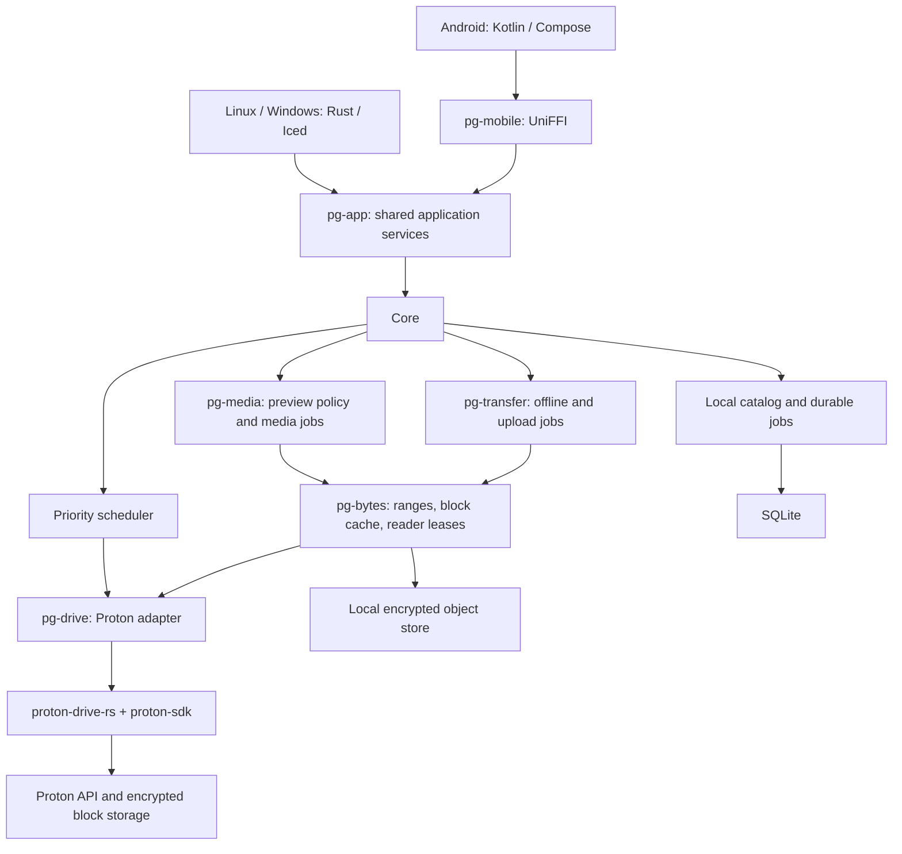

# Architecture

Planning baseline: 2026-11-17; application ownership updated 2026-11-18. `pg-core`, `pg-drive`, `pg-app`, `pg-mobile`, and `pg-desktop` exist. Named scheduler/media/transfer crate extractions below remain proposals.

## 1. System boundary



The scheduler is a shared service injected into every network/CPU consumer, including the bytes layer. The diagram does not imply that only metadata calls are scheduled. A separate player adapter consumes `pg-bytes` and renders decoded video through platform APIs.

Start with `pg-core`, `pg-drive`, and `pg-cli`, with internal modules for catalog, scheduling, bytes, media, and transfers. Extract the named `pg-*` crates as interfaces settle; avoid creating many empty crates before the first vertical slice works. Frontend boundaries must be maintained from the beginning.

| Boundary | Responsibility | Must not own |
| --- | --- | --- |
| `pg-app` | Account/session lifecycle, library queries, Photos/album sync, media retrieval | Frontend presentation state or platform credential implementation |
| `pg-core` | Catalog, indexing, byte storage, geometry, typed IDs and errors | UI widgets or Android lifecycle |
| `pg-drive` | SDK adaptation, account/source access, metadata pages, revision descriptions, remote writes | Product-specific offline policy |
| Catalog module | Migrations, local queries, scan/event checkpoints, durable intent | Network calls while a transaction is open |
| Scheduler module | Priority, cancellation, deduplication, resource permits | Unbounded task spawning |
| `pg-bytes` | Immutable revision reads, block map, local object store, memory budgets, leases | Player UI or album semantics |
| `pg-media` | Thumbnail/preview selection, extraction jobs, format capability and decode limits | A second HTTP/cache stack |
| `pg-transfer` | Persistent jobs, folder policy expansion, local completion, upload recovery | An Android-only parallel job database |
| `pg-ffi` | Coarse DTOs, opaque handles, explicit job cancellation, lifecycle adaptation | An independent copy of core logic |
| Desktop / Android | Rendering, input, accessibility, platform players, credential and task-host adapters | Authoritative download progress or synchronization rules |

The core is Rust. Native players and image decoders may use C/C++ libraries or platform APIs. Kotlin handles Android permissions, picker URIs, notifications, and OS task hosting. None of those changes the ownership of scheduling, durable transfer state, or byte access.

## 2. Reuse strategy

Use `proton-sdk` and `proton-drive-rs` as the shared protocol layer. Do not recreate SRP, OpenPGP, block-URL refresh, or Photos endpoints inside the gallery. The local SDK workspace declares `0.12.0`; `proton-stream` still declares `0.9.0`. Audit compatibility and published availability before pinning a release version.

Port the generic streaming/cache ideas and relevant tests from `proton-stream`, preserving attribution. Its current `pstr-stream` depends on the show-oriented `pstr-core`; taking it as a direct application dependency would import an unsuitable domain model. First adapt a minimal generic byte layer into the gallery. Consider a published shared streaming crate after the gallery's requirements stabilize, without making a cross-repository refactor a prerequisite.

Study `proton-drive-linux` for photo indexing, pinning, cache publication, event application, and upload behavior. Do not depend on its daemon, FUSE layer, GTK UI, database schema, or Linux-specific key handling. Never open a sibling application's database for writes or silently adopt its login credentials.

Release builds must work from this directory as an independent checkout. Registry dependencies or an explicitly pinned SDK commit are acceptable during development; implicit `../` dependencies and committed local Cargo patches are not release inputs.

## 3. Sources and identity

MVP: one signed-in account, the normal Proton Photos library as the default view, and a separate Drive tab for explicitly selected folders as nested galleries. Photos is part of the first delivery. Public share links remain a later extension. [Current product direction](PRODUCT.md) supersedes the original folder-first ordering.

Define source capabilities rather than assume every source supports folders, event cursors, uploads, or albums:

```text
SourceCapabilities { paged_listing, events, folders, albums, upload, revision_reads }
Source -> list_page(scope, opaque_cursor), resolve_nodes(ids), list_changes(cursor)
RevisionSource -> open_revision(asset, expected_revision) -> descriptor + range reader
ThumbnailSource -> thumbnails(asset_ids, variant) -> per-asset outcomes
```

These are conceptual contracts, not claims that the SDK already exports matching methods. Add SDK pagination and verification APIs where needed; protocol work belongs in the SDK.

Photos random access is also an explicit SDK gate: the inspected revision opener uses ordinary Drive link/key routing, while Photos metadata and thumbnails use Photos-aware helpers. Validate Photos-video range access independently and add the appropriate revision opener before advertising streaming from that source.

Stable asset identity is `(account_namespace, volume_id, node_id)`; source membership is a separate relation. A photo shown in a folder and an album should reference one asset. Cache identity includes account namespace, revision ID, block index, and representation. Names and paths are presentation data, never identity or object filenames. Do not deduplicate different accounts or distinct remote assets by filename or timestamp.

An open reader is pinned to one revision. Catalog refresh may announce a newer revision, but cannot replace bytes in an existing reader. Every async result also carries an account/session generation so work started before logout cannot publish into a new session.

## 4. Catalog and query model

Use SQLite with one write executor and a small read pool, WAL, short transactions, foreign keys, a bounded busy timeout, and checkpoints off the UI thread. Store it on a local filesystem. SQL and filesystem operations run away from render threads. WAL permits reads alongside writes, but still has checkpoint and concurrency constraints; measure them using [SQLite's WAL guidance](https://www.sqlite.org/wal.html).

Proposed logical tables (final schema comes with migrations):

| Table | Key / essential data |
| --- | --- |
| `accounts` | Local namespace, credential reference, session generation; no tokens |
| `sources` | Account, kind, remote scope, display name, capabilities, enabled state |
| `assets` | Account + volume + node, media kind, dimensions, duration, MIME, size, active revision, capture time and provenance, remote status |
| `revisions` | Asset, revision ID, length, validated block map, available integrity evidence |
| `memberships` | Source/album/folder relationship to asset; avoid duplicating assets |
| `folders` | Stable node and parent IDs, bounded/cycle-safe traversal |
| `derivatives` | Asset + revision + variant + pipeline version; ready/missing/retry state |
| `objects` | Opaque object ID, representation, size, local digest, committed state, access cost |
| `revision_blocks` | Revision + index -> object, expected length and integrity metadata |
| `offline_requests` | User intent: item/folder, recursion, original quality, follow changes |
| `offline_members` | Request + asset + selected revision; multiple requests may retain one asset |
| `jobs` | Kind, target, state, checkpoint, retry time, policy, worker lease generation |
| `scan_checkpoints` | Scope, generation, continuation, complete/incomplete status |
| `event_inbox` / `sync_cursors` | Durable pending changes and transactional applied cursor |
| `local_preferences` | Storage limits, network policy, selected sources, view settings |

Keep rebuildable remote metadata separate from irreplaceable user intent. A catalog rebuild must preserve offline requests, upload jobs, local retention records, and settings. Use forward-only migrations; refuse a newer schema and preserve corrupt files for recovery.

Timeline and folder queries use bounded keyset pages, usually 100–250 items, ordered by `(effective_capture_time, stable_asset_id)` with a matching index. Add compound indexes for source membership and offline filters; validate plans with `EXPLAIN QUERY PLAN`. Use a local text index for filename/folder search only when needed. Never load or re-sort the whole library on each UI frame.

Capture date precedence: source-provided capture metadata, valid EXIF/QuickTime capture time, remote modification time, then discovery time. Preserve original date text/offset and provenance; timezone-less camera time is not a confidently known UTC instant. Pin the scroll anchor when new items or corrected dates arrive. Month/day counts are incrementally maintained; headers must not depend on decoding every original.

## 5. Initial scan and event correctness

1. Load local results and availability immediately after local unlock.
2. Restore/refresh the account session asynchronously; failure must not block offline browsing.
3. For a new scope, record an event baseline before scanning. Commit each metadata page and its checkpoint together and publish that page to the UI.
4. Scan the current folder first; crawl selected subfolders and older Photos pages incrementally. Scan metadata only, not full originals or every thumbnail.
5. Replay changes from the baseline to catch mutations during the scan. Apply idempotently; rehydrate current node state when required. Persist catalog updates and the applied cursor in the same transaction.
6. Subsequent launches resume the applied cursor. Expired cursors, subscriber lag, or incomplete event coverage trigger a scoped reconciliation while keeping local results visible.

The SDK's current `EventManager` broadcasts changes and saves its own cursor without waiting for the gallery's transaction. It is not sufficient as the authoritative catalog checkpoint. Use explicit enumeration plus transactional application, or extend the SDK with acknowledged durable delivery. If a poller cursor advances on inbox insertion, that inbox and cursor must commit together; delete inbox entries only after application commits.

A scan is not an atomic server snapshot. Do not infer deletion from an incomplete page sequence or failed scan. A completed reconciliation generation may mark unseen memberships after replay/recheck. Periodically reconcile selected scopes at low priority to repair missed or out-of-scope changes. An Android background stop cannot guarantee continuous freshness; expose last successful sync.

## 6. One scheduler and bounded resources

| Priority | Work |
| --- | --- |
| P0 | Active viewer range reads, playback deadlines, explicit open operations |
| P1 | Visible grid thumbnails, requested metadata page, current preview |
| P2 | Small directional look-ahead and adjacent-viewer previews |
| P3 | User-requested offline transfers and uploads |
| P4 | Deep indexing, reconciliation, derivative warming, repair |

Priorities are defaults: thumbnail traffic must not starve active playback, and sustained scrolling must not starve user transfers forever. Use separate small metadata/thumbnail and content lanes, weighted fairness with aging, and reserve foreground capacity. All lanes share a global byte-in-flight limit. A low-priority job cannot fill every SDK transfer permit before foreground demand arrives; account for nested SDK concurrency and expose a priority hook upstream if necessary.

Initial experiments: at most 6 content-block requests on desktop and 3 on Android, of which background work can occupy at most 2 and 1 respectively. Use a separate bounded thumbnail lane (start with 4). These are tuning inputs, not throughput claims. Bound queued intents too: viewport requests replace old viewport generations; background work remains durable rows rather than millions of spawned futures.

Single-flight revision opens, thumbnail batches, and block fetches. Promote shared work when a foreground consumer joins. Cancellation detaches one consumer; it must not cancel a block still needed by another consumer or a pin job. Stop obsolete work at safe boundaries and release permits. Explicit seek/viewport generations prevent late completions from updating the wrong view. CPU work that cannot be interrupted remains in a bounded worker pool; discard obsolete output before GPU upload.

Network calls need deadlines, exponential retry with jitter, `Retry-After` support, and account-wide backoff on throttling. Distinguish offline, auth locked, revoked access, URL expiry, corrupt data, unsupported media, and disk-full errors. Session refresh is single-flight and newly rotated credentials must be saved reliably. Storage URL expiry refreshes the same revision's URLs; it does not automatically mean account reauthentication.

## 7. Platform boundaries

Desktop: Rust/Iced calls `pg-app` directly. It owns window/input state, viewport requests,
visible focus, a bounded decoded-thumbnail cache and still-photo presentation. `pg-app`
serializes account transitions and gates shared operations against sign-out cleanup;
`pg-drive` cancels session work and guards refresh persistence. The Android UniFFI adapter
also uses `pg-app`; it retains Android-specific player, Keystore, MediaStore and task hosting.
The old Compose desktop skeleton remains until Iced acceptance is recorded. See
[desktop instructions](DESKTOP.md) and [measured acceptance](VALIDATION.md).

Android: Kotlin/Compose renders paged DTOs and handles gestures. Rust remains the source of truth for catalog and transfers. UniFFI exposes coarse queries, thumbnail batches, opaque reader handles, and explicit cancellation; avoid full decoded bitmaps, whole videos, or per-byte callbacks across FFI. Measure bounded copies before adding specialized JNI direct-buffer code. Test cancellation and teardown for the pinned UniFFI version; [UniFFI's async lifecycle documentation](https://mozilla.github.io/uniffi-rs/latest/internals/async-ffi.html) describes explicit future cleanup, but application job cancellation is still a separate contract.

OS adapters wake Rust jobs; they do not independently schedule every asset. Use one active transfer host per account/process, persisted leases, and bounded batches. Android 14+ offers user-initiated data-transfer jobs for long explicit transfers; deferrable refresh uses WorkManager. Older-version foreground execution needs a tested policy. No promise of execution after force-stop or while the OS withholds work. Follow [Android's transfer API selection guidance](https://developer.android.com/develop/background-work/background-tasks/data-transfer-options).

Provisional support floor: Android 12/API 31, matching the existing client; confirm during the Android spike. Linux x86_64 and Windows x64 first; Android arm64 first. Additional CPU architectures require explicit build/test coverage.

## 8. Local privacy and account lifecycle

Use a random per-installation, per-account content-store key wrapped by Linux Secret Service, Windows credential protection, or Android Keystore. Persist cached media/derivatives with an established authenticated-encryption implementation and unique nonces. Bind object identity and format version as associated data. Large offline files remain encrypted by independently readable blocks. Unlocked readers may hold bounded plaintext in memory; never promise forensic erasure of RAM or storage.

The initial SQLite design stores decrypted filenames, dates, dimensions, and job metadata in app-private storage. It is **not an encrypted metadata vault**. Tokens, key passphrases, content-store keys, and public-link fragments never go in SQLite or logs. Full catalog encryption is a separate decision that needs a supported encrypted SQLite build and migration/recovery testing. State this local metadata boundary clearly in settings and documentation.

Default offline storage is durable app data, not an OS purgeable cache directory. Android backups exclude credentials, wrapped keys, media, and incompatible database state. No plaintext export until the user explicitly exports/shares a selected asset. Exported copies have their own lifetime and must be clearly separate from retained app content.

Session expiry pauses remote work but retains already authorized offline access after local unlock. Explicit logout stops jobs and readers, increments generation, clears credentials, and offers the user a concrete choice about retained local content; default is removing account data. Any retained library needs a local unlock key independent of the expired session. Source removal cancels its policies without deleting cloud files. Remote deletion/revocation cannot remotely erase bytes already downloaded; the retention policy is described in [offline storage](OFFLINE_AND_STORAGE.md).

Logs and performance traces use opaque IDs, no filenames, GPS metadata, signed storage URLs, fragments, or credentials. No third-party media enrichment or analytics in the initial product. License review must distinguish MIT Rust source from GPL Android/UI/native distributions before copying code or shipping player binaries.
