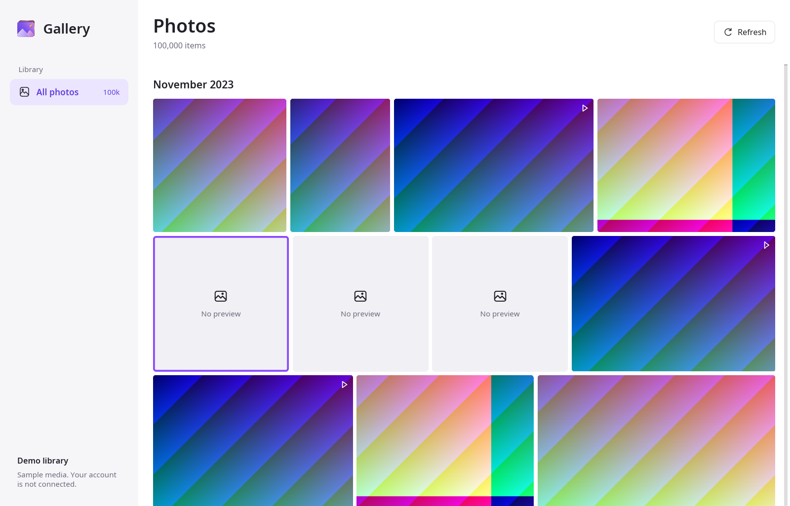
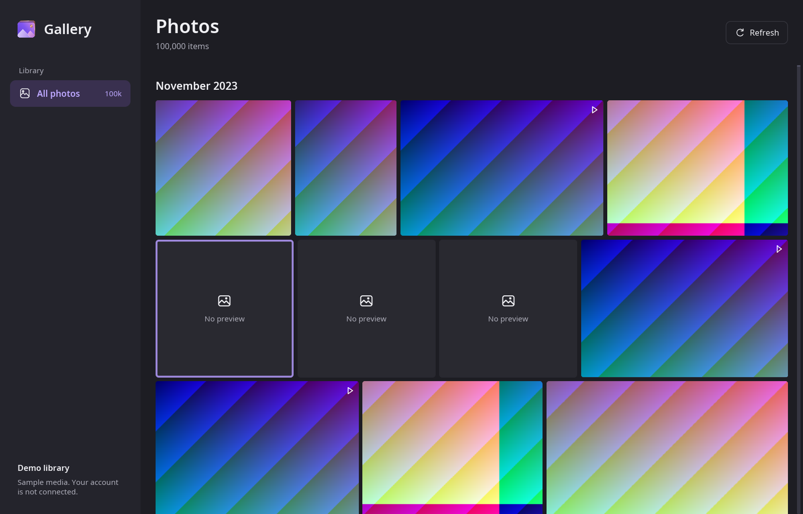

# Desktop browser: Iced on Linux and Windows

The desktop milestone is a native Rust/Iced application in `crates/pg-desktop`.
It covers account access, the Photos timeline and still-photo viewing. The earlier
Compose desktop skeleton remains in `desktop/` until Iced acceptance is complete;
it is not the Photos browser. Android keeps Kotlin/Compose and its UniFFI interface.

## Build and run

On Arch Linux, the local package builds this checkout in release mode and installs
the executable, launcher and icons:

```sh
cd packaging
makepkg -fi
```

Use `makepkg -sfi` if dependencies are missing. Launch **Proton Gallery** from the
application menu or run `proton-gallery`. See [packaging details](../packaging/README.md)
for prerequisites and Secret Service setup.

Install Rust (workspace minimum 1.96) and the platform development libraries. On
Debian/Ubuntu the CI dependencies are `libdbus-1-dev libxkbcommon-dev libwayland-dev
libudev-dev libegl1-mesa-dev`. A functioning Wayland or X11 display and graphics driver
are needed to run; Windows builds use the MSVC toolchain and Windows SDK.

```sh
cargo run -p pg-desktop --bin proton-gallery --locked
cargo run -p pg-desktop --bin proton-gallery --locked -- --demo 100000
cargo run -p pg-desktop --bin proton-gallery --locked -- --data-dir /path/to/gallery-data
```

`--demo [COUNT]` uses an account-free fixture library (100,000 items by default,
maximum one million). Its generated temporary directory is owned and removed by the
process. An explicitly supplied `--data-dir` is preserved, including in demo mode.
Do not point demo mode at an existing account catalog: it writes synthetic source records.

The default directory comes from `directories::ProjectDirs` for `io/narl/Proton Gallery`,
with a `desktop` subdirectory. On Linux this is normally
`$XDG_DATA_HOME/protongallery/desktop` (or `~/.local/share/protongallery/desktop`);
on Windows it is under `%LOCALAPPDATA%\narl\Proton Gallery\data\desktop`.
Logs default to warnings; `PG_LOG` accepts tracing filters.

## Account and media behavior

- Sessions live in Linux Secret Service or Windows Credential Manager. If a keyring
  is unavailable, the user must opt into a session that ends when the app closes.
- Sign-in supports authenticator codes, a separate mailbox password, and CAPTCHA
  continuation through the shared Rust API. “Open verification page” creates a temporary
  browser page embedding Proton's verification UI. It accepts messages only from the
  verification iframe at `https://verify.proton.me`, displays its CAPTCHA token, and asks
  the user to copy/paste that token into Gallery. The page never receives account passwords
  or session credentials, and is deleted on continuation/cancellation. Live Proton
  CAPTCHA behavior still needs real-account acceptance.
- Restoration failures appear in the sign-in screen with a retry action. Keyring deletion
  failures detach the account, clear the displayed library and catalog, stop account work,
  and present “Retry cleanup”. A persistent cleanup marker also blocks restoration after
  restart until cleanup succeeds.
- Sync updates preserve the viewport anchor and keyboard focus by asset identity.
  Decoded shapes and resizing replan around the current anchor. Below 760 logical pixels,
  the sidebar collapses into a toolbar; account sign-out remains available.
- Arrow keys, Page Up/Down, Home/End and Tab move visible grid focus. Enter/Space opens;
  Escape closes; Left/Right navigate the viewer. R/F5 retries the viewer; F5 refreshes the grid. Tiles are buttons with a visible focus
  border. This does **not** establish screen-reader accessibility; see acceptance gaps.
- The still viewer uses Proton's preview, falling back to a streamed original when absent.
  Scroll to zoom, drag to pan. Retry reloads an unsuccessful item. Video shows a preview
  and an explicit playback-unavailable message; desktop video is outside this milestone.
- The light and dark Gallery palettes follow Iced's system-theme notifications. `PG_SCALE_FACTOR=1.25`
  adds an application scaling override for reproducible layout checks (default 1).

## Desktop presentation

The library uses a quiet navigation rail, a single Photos heading with the item count,
and a justified timeline with 24-pixel outer margins and six-pixel gutters. Violet marks
selection and keyboard focus; photos carry the color. Native outline icons and the existing
Gallery branding are embedded in the executable, with no icon-font dependency. The system
sans-serif font uses a 12/14/17/22/30-pixel type scale and semibold headings.

Sign-in has labeled fields, consistent rounded controls, and a centered form that scrolls on
small windows. The still viewer keeps a dark canvas in either system theme, with inset
images, visible navigation labels, and a compact zoom/pan hint. Sync errors appear below the
toolbar without replacing the library count. The sidebar hides below 760 logical pixels.

The light and dark library previews below use deterministic fixture media, including
unavailable thumbnails; they do not show a real account.





## Work and memory bounds

Only viewport rows plus 800 logical pixels of overscan on either side become widgets.
The outline retains compact identity/time/shape data for the entire catalog. Pages contain
100 records; at most four page reads and twelve thumbnail tasks are outstanding. Record
pages far from the viewport are evicted. Failed pages and failed/missing/unsupported
thumbnails are remembered and retried through Refresh. Stale results are checked before
removing current request bookkeeping. Outline replacement aborts obsolete page/media tasks;
viewer replacement and closing explicitly abort the old task.

The decoded thumbnail cache is limited to 160 MiB. At most two blocking decoders run;
their permits remain held even after a caller cancels. Each decoder applies image limits
before allocation: 16,384 pixels per side and a 128 MiB allocation limit. Grid images
are reduced to 320 pixels on their longest side; still-viewer output to 2,560 pixels.
The desktop original download/read limit is 32 MiB, enforced while streaming and while
reading. Unsupported/oversized images produce a retryable viewer message.

Originals use uniquely named temporary files with cleanup on failure, dropped futures and
publication failure. Shared account ownership is validated before cache reuse. A read/write
operation gate makes sign-out wait for outstanding shared work before catalog and original
cache cleanup; account transitions themselves are serialized. Decrypted originals are
removed at next startup and sign-out. This is an ephemeral viewing cache, not offline retention.
These bounds do not cap total RSS or GPU/driver allocations. SDK thumbnail downloads check
encoded-size limits after the SDK returns its buffer, so the SDK's own temporary allocation
is not proven bounded by the application limit.

## Shared ownership and validation

`pg-app` owns account transitions, library queries, Photos/album sync and media retrieval.
`pg-drive` owns SDK protocol/session adaptation; `pg-core` owns catalog/indexing and geometry.
`pg-desktop` owns presentation state, decoding, viewport scheduling, OS keyring adaptation and
input. Android continues through the existing `pg-mobile` UniFFI API and its platform adapters.
The demo's `FixtureMedia` implements the same `MediaProvider` contract as `App`: encoded
still images, absent bytes, unsupported bytes and failed downloads all use the regular loading
and decoding path. Synthetic videos use the normal video placeholder path.

```sh
bash scripts/check.sh
JAVA_HOME=/usr/lib/jvm/java-21-openjdk /usr/bin/gradle8 -p android --no-daemon testDebugUnitTest lintDebug assembleDebug
cargo build -p pg-desktop --locked
python3 scripts/desktop-smoke.py --backend wayland --cycles 6
python3 scripts/desktop-smoke.py --backend x11 --scale 1.25 --check-theme
```

The Linux runtime helper needs Pillow; X11 uses an isolated Xvfb display `:98` and libXtst;
Wayland uses the installed Hyprland Lua IPC. It operates only the child Gallery window,
records screenshots/logs/summary JSON under `/tmp/pg-*`, drives repeated browsing and viewer
navigation, and samples process RSS. `PG_METRICS=1` records CPU widget construction and
instrumented redraw intervals, including scheduling/idle stalls; it is not GPU frame time.
The frame subscription itself requests ongoing redraws, so this measures an instrumented run.

Linux and Windows CI compile the executable and run shared/desktop tests. This is separate
from runtime acceptance. Exact measured results and outstanding Windows, screen-reader,
real-account and display checks are recorded in [VALIDATION.md](VALIDATION.md).
