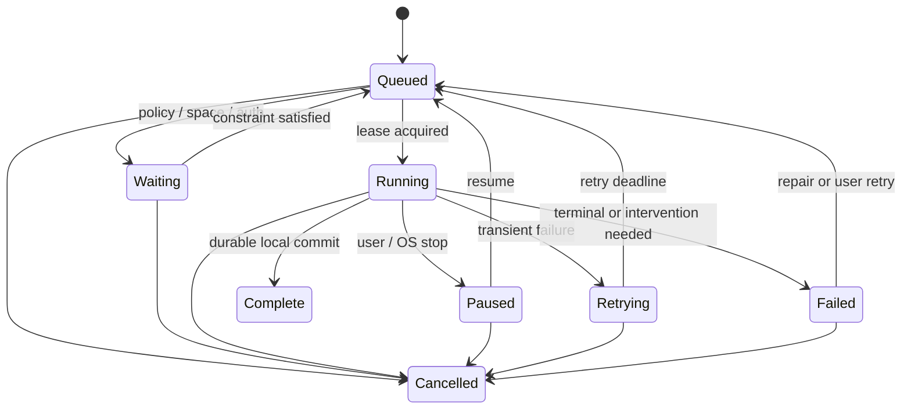

# Offline availability and storage

## 1. User contract

The initial `Keep offline` action retains **original quality**, including all video blocks. A thumbnail or a buffered video prefix is not an offline original. Existing cached previews can be viewed without a network, but the UI labels their availability separately.

Actions: keep an item; keep a folder recursively; pause/resume transfer; stop keeping; remove local download; clear disposable cache. Unpinning or removing a download never deletes anything from Proton. Explain inherited folder retention when a user tries to remove one item still covered by a folder request.

Folder retention follows future changes while that source remains selected. It downloads media descendants and traversal metadata; unrelated documents are skipped and counted. Albums use membership rather than folder ancestry and can later support the same policy. Offline preview-only packs are a later explicit quality option, never a reinterpretation of the default action.

## 2. Separate intent, work, and availability

These are distinct dimensions:

- **Intent:** requests the user made, including recursive folder policies.
- **Job:** queued, waiting for a constraint, running, paused, retrying, failed, cancelled, or complete.
- **Availability:** none, preview only, partial original, complete original, or last complete revision with an update pending.
- **Remote status:** present, deleted remotely, access revoked, or unknown while disconnected.

An item can be fully available while an update job fails. A cancelled job may leave useful partial blocks. Multiple folder/item requests may retain the same revision; unpinning one request cannot remove another request's bytes.

Stopping an OS worker checkpoints/preserves the Rust job; the worker is not the authoritative state machine. Progress events are throttled, coalesced, and reconstructible from committed block records after a crash.

## 3. One object store for cached and retained bytes

Use encrypted, immutable local blocks addressed by account, asset, revision, and block index through an opaque object ID. Derivatives use separate representation keys. Pin state lives in transactional retention references; the file format does not change when a cached block becomes retained.

The same block may satisfy a viewer, an offline request, and another overlapping request. Reuse it without network refetch or a second full-file copy. A complete offline range reader opens from local descriptors and objects **before any remote revision lookup**; this is essential for airplane mode and expired sessions.

Offline completion requires:

1. A durable revision descriptor with length, validated block map, representation, and locally required metadata.
2. Every required block committed and readable, with its expected length and local integrity check.
3. A durable reference from at least one offline request.
4. Any required locally wrapped keys available after local unlock.
5. A transaction recording completion only after those conditions hold.

Generate and retain a grid thumbnail where possible. An unsupported thumbnail does not invalidate a fully retained original. Playback capability and byte availability are separate: an offline file with an unsupported codec remains downloaded and can be exported.

Local AEAD/digests prove that stored bytes have not changed since local publication; they do not substitute for remote manifest/signature verification. The SDK currently skips whole-file manifest verification on partial reads, and its whole-download verification outcomes need an API audit. Persist truthful integrity states such as `local_complete`, `remote_verified`, `unverifiable`, or `verification_failed`. Never display an authenticity claim inferred merely from successful decryption. A typed revision-manifest verifier that can validate a completed block set is an SDK milestone.

## 4. Crash-safe publication

Files and SQLite do not share an atomic transaction. Make the write ordering and recovery explicit:

1. Acquire a job lease with generation and reserve expected disk bytes plus encryption/working overhead.
2. Fetch/decrypt only missing blocks. Validate block identity/length; record supported remote integrity evidence.
3. Encrypt a block into a unique staging file on the same filesystem as the object store. Use an established AEAD implementation; authenticate identity/version in associated data and generate unique nonces.
4. Flush and sync, atomically publish the immutable object, and use platform-appropriate directory durability. Windows replacement/open-handle semantics need their own tested implementation.
5. In a short database transaction, register the object and revision mapping, advance the job checkpoint, and update retention references. Do not persist completion before publication.
6. After every block is present, validate completeness and commit the availability change. Emit completion after the commit.

Crash before object publication leaves staging garbage; crash between publication and database commit leaves an orphan. Startup recovery removes expired staging data and adopts or garbage-collects verified orphans without claiming a truncated file is complete. A database row whose object is absent/corrupt becomes a missing block and a repair job. Never serve arbitrary zero-filled holes from a sparse file as valid media.

Keep jobs idempotent. A resumed worker with an obsolete lease generation cannot publish completion. App UI and Android task host share a process engine or coordinate through durable leases and a process lock; two workers must not transfer the same job independently. Expired leases are recoverable after process death.

Do not scan or hash all retained objects synchronously at every startup. Recover active/staging transactions first, use the durable index for normal opens, validate objects as read, and perform a low-priority scrub. Large-library startup must remain bounded.

## 5. Folder expansion and changing cloud content

Create an offline request immediately, then expand it through bounded metadata pages. Persist the traversal frontier and checkpoints. Show `Discovering…` with known file/byte counts; unknown totals are not zero-byte completion. Detect cycles and protect against unreasonable depth. Completion is relative to a finished discovery/reconciliation generation and selected revisions, not a forever-complete assertion about a mutable folder.

| Change | Policy |
| --- | --- |
| New media under a retained folder | Add a member and enqueue within network/storage constraints |
| Rename or move within retained scope | Update metadata/membership; do not redownload unchanged revision |
| Move out of retained scope | Remove that inherited retention reason; preserve other direct/folder reasons and active reader leases |
| New revision | Keep the last complete revision available while downloading the replacement; swap current availability only when the new revision is complete |
| Remote deletion or loss of access | Mark remote status and stop retry storms; preserve an already complete explicitly retained copy as `local copy; removed/unavailable remotely` until the user removes it |
| Incomplete scan / network failure | Preserve prior membership and last complete revision; do not infer deletion |
| User removes source | Stop new work, remove that source's policies, and present a local-data retention choice; never delete cloud content |

For an old-revision fallback, show its date/status and allow opening it. Active readers keep their revision lease during replacement; garbage collection waits for them. Partial superseded revisions can be reclaimed after cancelling obsolete jobs. A remote revoke cannot make an already downloaded copy disappear from other devices; the product must not imply such a guarantee.

## 6. Eviction and space

Storage classes: reconstructible thumbnails/previews, opportunistic original blocks, user-retained original blocks, staging/reservations, database/keys. App-owned offline data lives in a durable directory; a system cache purge must not remove the objects behind an offline badge.

Evict only unretained, unleased objects. Default policy can start with size-aware LRU, preserving small expensive-to-refetch thumbnails separately from large streamed-video blocks. Do not allow a movie stream to evict the whole thumbnail working set. Eviction selection and retention changes serialize so an object cannot be pinned between selection and deletion without rechecking.

Maintain persisted references for requests and in-process read leases for active consumers. After a crash, reconstruct durable references and expire dead leases before GC. Cache clearing never removes pinned objects. A direct item pin is distinct from recursive folder policy; removing one does not remove the other.

Show separate used sizes for thumbnails, disposable media, retained originals, and incomplete transfers. Account for object/header/nonce overhead, staging writes, reservations, and old/new revision overlap. Folder estimates improve during discovery; they are not an exact promise while membership changes.

Start with a minimum free-space reserve of `max(512 MiB, 5% of filesystem capacity)`, capped/configurable after testing. Reserve ahead of each bounded batch. When estimates exceed space, stop adding transfer work and present the shortfall; never silently downgrade original quality or evict user-retained files. Handle actual `ENOSPC` and concurrent external disk use safely even after preflight succeeds. Keep room for database commits and recovery.

If replacement space is unavailable, retain the old complete revision and mark the update blocked. Do not delete the user's only complete copy to make room implicitly. Downloads resume after the user frees space or changes retention.

## 7. Network and platform policy

Background work defaults to unmetered networks; foreground open/play is an explicit action with visible data-use behavior. Provide `allow metered downloads` and optional charging-only bulk work. Map OS connectivity and battery restrictions to Rust policy, and re-evaluate already queued jobs when settings change.

On Android, host long user-requested transfers using an eligible user-initiated transfer job on API 34+; use WorkManager for deferrable folder updates and small synchronization. Choose and test older-platform foreground-service fallback before enabling long transfers there. Android 16 long-running workers may exhaust job quota, so copying the existing per-episode WorkManager setup unchanged is insufficient; see [Android's long-running worker guidance](https://developer.android.com/develop/background-work/background-tasks/persistent/how-to/long-running).

OS termination checkpoints at safe boundaries; later scheduling resumes the persisted Rust job. Force-stop, reboot, doze, lost notification permission, and OEM power restrictions have different behavior and need device tests. The UI reports paused/waiting work rather than promising uninterrupted background execution.

Desktop initial behavior: transfers run while the app/explicit tray mode is running, resume after restart, and checkpoint on suspend/shutdown. An always-on system daemon or Windows service is not an initial requirement.
